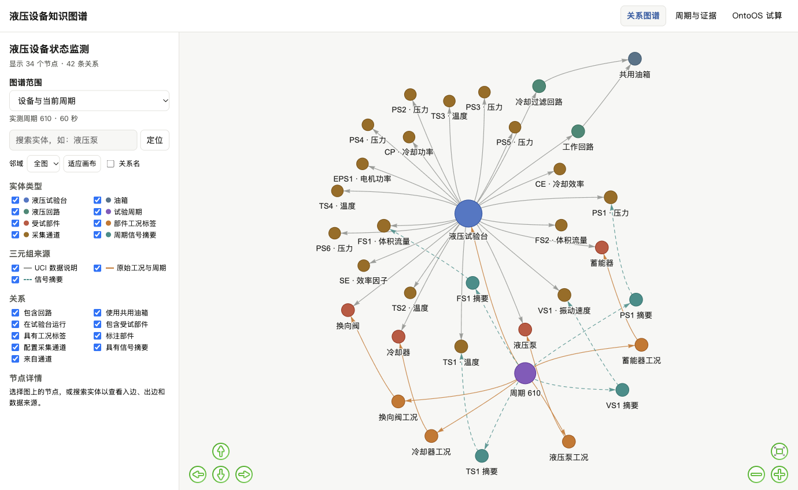
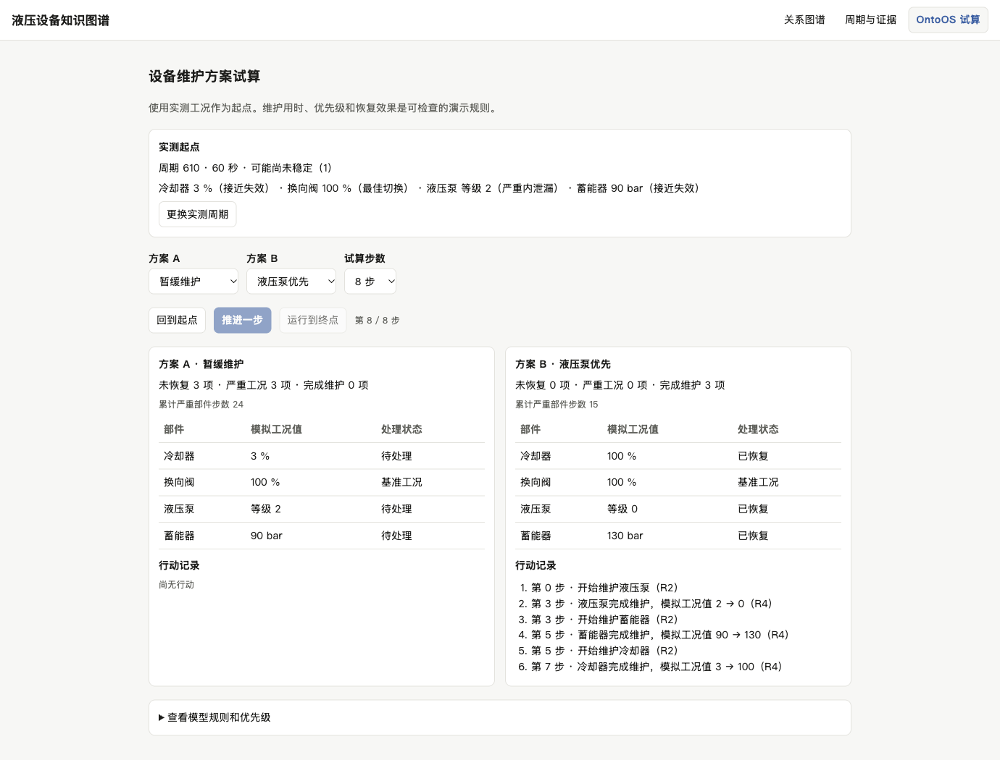

# 液压设备状态监测本体

将 UCI 447 液压试验台的 2,205 个实测周期组织为可查询的 RDF。每个周期持续 60 秒，关联冷却器、换向阀、液压泵和蓄能器的工况标签，以及压力、流量、温度和振动四个通道的信号摘要。试验条件由研究人员设置，周期编号对应原始文件从 1 开始的行号。

## 在线演示

**[打开交互式图谱](https://hhhhhh1140.github.io/hydraulic-equipment-ontology/)** · [液压泵一跳邻域](https://hhhhhh1140.github.io/hydraulic-equipment-ontology/?focus=Pump&hops=1) · [第 610 周期维护试算](https://hhhhhh1140.github.io/hydraulic-equipment-ontology/?cycle=610&view=sandbox)

| 能做什么 | 上手示例 |
|---|---|
| 看图谱和邻域 | 搜索「液压泵」，切换「一跳」，查看连到试验台和工况标签的两条入边 |
| 从工况追溯原始测量 | 在「周期与证据」筛选「严重泵内泄漏 + 蓄能器 90 bar」，定位到命中的 123 个周期 |
| 对比两个维护方案 | 在「OntoOS 试算」用第 610 周期作为共同起点，运行 8 步，并查看每项动作触发的规则 |

### 液压设备关系图

[](https://hhhhhh1140.github.io/hydraulic-equipment-ontology/)

### 维护方案沙盘

[](https://hhhhhh1140.github.io/hydraulic-equipment-ontology/?cycle=610&view=sandbox)

## 在 VS Code 里打开

1. 打开 [hydraulic-equipment-ontology.code-workspace](hydraulic-equipment-ontology.code-workspace)，或者在 VS Code 里选择 **文件 → 打开文件夹**，选中本项目目录。
2. 用浏览器打开 [visualization/index.html](visualization/index.html)。页面可离线使用，可切换「关系图谱」「周期与证据」和「OntoOS 试算」。
3. 如果希望在 VS Code 内查看页面，在项目终端运行 `python3 -m http.server 8765 --bind 127.0.0.1 --directory visualization`，再用命令面板的 **Simple Browser: Show** 打开 `http://127.0.0.1:8765/`。Windows 按本地 Python 安装情况将 `python3` 改为 `python` 或 `py -3`。

## 项目目录

| 路径 | 内容 |
|---|---|
| [onto-model/](onto-model/) | Onto-Model 的可编辑 YAML 工作区，定义 8 个概念和 9 种对象关系 |
| [model/ontology.ttl](model/ontology.ttl) | OWL 类、对象关系、属性和来源 |
| [model/instances.ttl](model/instances.ttl) | 165,542 条 RDF 实例三元组，覆盖全部试验周期、17 个通道元数据和 4 个通道的摘要 |
| [model/shapes.ttl](model/shapes.ttl) | SHACL 约束，校验关联数量、字段类型和必填项 |
| [model/validation.txt](model/validation.txt) | 校验结果和上游原始数据 SHA-256 |
| [queries/](queries/) | 3 条可直接对实例运行的 SPARQL 查询 |
| [visualization/](visualization/) | 离线关系图、周期证据、维护试算及其源文件 |
| [scripts/build.py](scripts/build.py) | 读取 UCI 原始 ZIP，重建 YAML、RDF、查询和展示 |
| `data/source/` | 本地原始数据缓存。GitHub 克隆可通过重建命令下载同一份 UCI ZIP |

## 模型逻辑

- **设备对象**。液压试验台包含主工作回路、次级冷却过滤回路和四种受试部件。两条回路共用油箱。采集通道关联试验台。
- **工况标签**。试验周期 → 部件工况标签 → 受试部件。工况值按部件解释，例如液压泵的标签值 2 表示严重内泄漏。
- **信号依据**。试验周期 → 周期信号摘要 → 采集通道。PS1、FS1、TS1、VS1 分别用同一周期的 6,000、600、60、60 个样点计算均值、最小值和最大值，保留四位小数。
- **来源对齐**。工况来自 `profile.txt`，信号摘要保留通道文件名，用原始行号关联。稳定性标记 1 表示实验设置可能尚未稳定。

查询得到 **492 个严重泵内泄漏周期**，其中 **123 个同时标注蓄能器为 90 bar**。展示打开第 610 个周期，可查看对应的工况和测量证据。适用范围是试验数据的筛选、对照和溯源。

## 关系图谱

沿用线性代数图谱的布局。左侧检索实体，按类型、来源和关系筛选。右侧可以拖动画布、缩放和点选节点，查看入边、出边和证据。实例视图显示试验台、17 个通道及当前周期的相关记录。概念视图显示 8 个类和 9 种对象关系。“周期与证据”切换行号后，实例视图和试算起点一起更新。

可在 URL 中用 `?cycle=610&focus=Pump&hops=1` 打开液压泵一跳邻域，用 `?scope=schema&focus=TestCycle&hops=2` 浏览试验周期的概念邻域。图谱渲染依赖随项目保存的 [vis-network 10.1.5](https://github.com/visjs/vis-network/releases/tag/v10.1.5)，许可证位于 `visualization/vendor/`。

## OntoOS 风格维护沙盘

在「周期与证据」选择一个实测周期，再进入「OntoOS 试算」。左右方案共享这一周期的四项标签作为起点。可选择暂缓维护、液压泵优先、蓄能器优先或最短工序优先，并逐步推进或一次运行到指定步数。两个方案分别显示状态、统计指标和触发规则。规则实现位于 [simulation-model.js](visualization/simulation-model.js)。

- 演示假设只有一组人员，同步最多维护一个部件。冷却器、换向阀、液压泵和蓄能器的工序耗时分别预设为 2、1、3、2 步。
- 工序结束后，仅更新该部件的模拟工况为基准值。原始试验周期和传感器数据保持只读。
- 以第 610 周期为例，运行 8 步后，暂缓方案仍有 3 项严重工况。液压泵优先方案按规则完成了 3 项维护。累计严重部件步数分别为 24 和 15。
- 这是一套本地演示规则。维护用时、恢复效果和累计指标用于解释方案比较，真实维护效果需要独立数据和工程模型验证。

用 Node.js 运行调度规则测试：

```bash
node --test tests/simulation.test.cjs
```

## 用 Onto-Model 查看图谱

按 [Onto-Model 官方仓库](https://github.com/sharptoolbox/Onto-Model) 的 README 启动本地后端和前端。选择 **打开工作区**，填入本项目下 `onto-model` 目录的绝对路径。模型树可查看属性，知识图谱可查看概念之间的关系。该工具采用 MIT 许可证，本工程已用其工作区服务读取校验。

`scripts/build.py` 根据同一套定义生成 YAML 和 OWL。只想在 Onto-Model 中试改关系时，可以编辑 YAML。需要重建一致的 YAML、OWL 和展示时，在 `scripts/build.py` 中更新模型定义后运行重建。

## 重建与查询

环境需要 Python 3.11 或更新版本。建议先在 VS Code 中选择一个项目虚拟环境，然后在项目根目录运行：

```bash
python -m pip install -r requirements.txt
python scripts/build.py --download
```

已有原始 ZIP 时可用 `python scripts/build.py --archive /path/to/hydraulic-uci.zip`。使用 `--onto-model /path/to/Onto-Model` 可加跑 Onto-Model 的工作区校验。

单独校验实例：

```bash
pyshacl -s model/shapes.ttl model/instances.ttl
```

运行周期溯源示例：

```python
from pathlib import Path
from rdflib import Graph

facts = Graph().parse("model/instances.ttl", format="turtle")
query = Path("queries/03-cycle-evidence.rq").read_text(encoding="utf-8")
for row in facts.query(query):
    print(*row)
```

## 数据来源与许可

Helwig, N., Pignanelli, E., & Schütze, A. (2015). *Condition monitoring of hydraulic systems*. UCI Machine Learning Repository. [DOI 10.24432/C5CW21](https://doi.org/10.24432/C5CW21)。原始数据依 [CC BY 4.0](https://creativecommons.org/licenses/by/4.0/) 授权。本项目对原始数据做了字段映射、中文注释和周期聚合。
