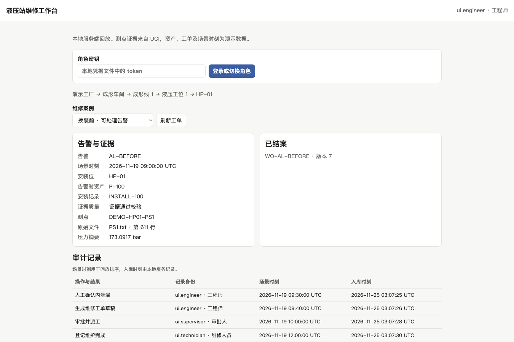

# 液压站维修工作台 · 服务端试点

这一阶段把浏览器回放扩展为可持久化的本地服务。设备、告警及场景时刻仍使用合成工厂样例，UCI 信号证据沿用已校验的实测周期。公开演示继续提供静态回放，本项目的服务端工作台由本地 Node.js 进程提供。



## 启动

安装 Node.js 22.13 或更新版本。用 VS Code 打开项目，在根目录终端运行：

```bash
node service/server.cjs
```

打开 [本机工作台](http://127.0.0.1:8766/)。首次启动会在 `.runtime/demo-credentials.json` 生成三个本地角色密钥。打开文件并复制对应 `token` 到「角色密钥」框。工单和审计记录保存于 `.runtime/maintenance.sqlite`。二者都在 Git 忽略范围内。

| 角色账号 | 负责动作 |
|---|---|
| `demo.engineer` | 确认故障、创建工单草稿、提交复测和结案 |
| `demo.supervisor` | 审批并派工 |
| `demo.technician` | 登记维修完成 |

选择「换装前」案例，用工程师身份确认并生成草稿。切到审批人完成派工，再切到维修人员登记完工。最后用工程师身份提交复测。第 612 周期复测未通过，工单仍待复测；第 1788 周期复测通过后可结案。重启服务后，原有工单状态和审计记录会恢复。

## 数据与接口

导入器用同一份 UCI RDF 和三份工业回放数据生成 [replay.json](../model/industrial/replay.json)。它是服务读取的快照，并随 SHACL 和七天查询一起构建。服务启动只需 Node.js 和已生成的快照。更改样例数据后可用 `python scripts/build_industrial.py` 重建。可用 `--snapshot 路径 --runtime 路径` 指定独立的快照和运行目录，数据库保留快照指纹以维持归属及审计的一致性。

| 请求 | 结果 |
|---|---|
| `GET /api/cases` | 当前登录角色、工厂层级、规则版本和案例列表 |
| `GET /api/cases/{id}` | 告警归属、原始证据、工单状态、版本、可用动作和审计记录 |
| `POST /api/cases/{id}/actions` | 在角色与状态检查后提交动作，事务内写入审计并返回更新状态 |

接口使用 `Authorization: Bearer <token>`。提交动作时提供 `action`、当前 `revision`、本次 `requestId`。复测还需提供所选 `retest`。重复同一请求会返回已记录的状态，旧版本会收到 `409`，角色不符会收到 `403`。审计记录包含登录身份、动作结果、规则版本、回放场景时刻和服务入库时刻。已接收但未通过的复测也会留痕。

运行 `node --test tests/*.test.cjs` 会在临时本地端口验证角色权限、无效证据、并发提交、复测阻断和重启恢复。面向真实工厂的下一阶段输入仍为设备台账及换装记录、带时间戳的测点历史和已确认的故障与维修工单。部署到现场网络前，需要使用企业身份、授权和部署体系替换本地演示凭据，并由现场人员确认数据权限及流程。
