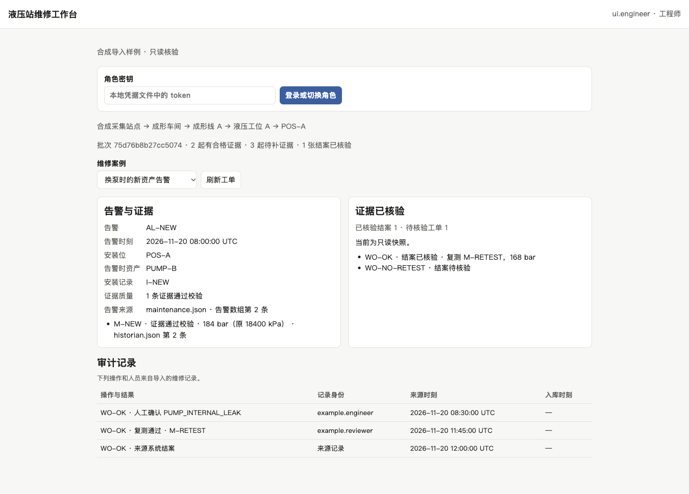

# 现场数据接入与只读核验

这一阶段校验导入数据，并将核验通过的观测与结案工单映射到工业 RDF 本体。仓库附带的是合成样例。实际现场导出与生成产物适合保存在 Git 忽略的 `.runtime/` 目录。



## 准备三份输入

参考 [合成样例](../data/plant-intake-example/)。每个文件为 UTF-8 JSON，`schemaVersion` 为整数 1。第一版按一套液压工位接入。ID 用大写字母、数字和连字符组成，并在同类记录中保持唯一。所有业务时间须带时区。报告中的条目编号从 1 开始，定位到相应的 JSON 数组。

| 文件 | 字段与用途 |
|---|---|
| `assets.json` | `plant` 有 `id/name/area/center/unit`，`position` 有 `id/name`。提供 `assets`、`installations`、`tags` 三组记录。安装记录使用 `[from, until)`，未结束用 `null`。资产记录填写 `id/name`。测点声明 `id/label/position/quantity/unit`。可用 `isSample: true` 标记合成样例。 |
| `historian.json` | `measurements` 中每条记录有 `id/tag/at/value/unit/quantity/quality`。数值为 JSON 数字，第一版支持压力单位 Pa、kPa、MPa、bar，`quantity` 用 `gaugePressure` 或 `absolutePressure`。读数须由源系统标为 `good` 才会作为证据。 |
| `maintenance.json` | `asOf` 指定快照截止时刻。`alarms` 按 `id/position/at/measurementIds` 对齐。`workOrders` 用 `id/alarm/asset/status` 关联。待办状态为 `planned` 或 `inProgress`。结案字段为 `faultCode/confirmedBy/confirmedAt/approvedAt/completedAt/retestId/retestResult/retestBy/closedAt`。 |

测点的物理量必须与台账一致。压力单位可以转换，表压与绝压各保留其业务含义。告警证据必须早于或等于告警时间，且属于告警时的同一条安装记录。结案校验使用来源系统已记录的人工确认和复测结论，并要求合格复测发生在完工之后。压力量值本身不用于判断内泄漏或推断修复。

## 导入和检查

在项目根目录运行：

```bash
python -m pip install -r requirements.txt
python scripts/import_plant.py --input data/plant-intake-example
```

实际导入时把 `--input` 换成经授权的三份脱敏导出所在目录。工具将结果按源文件 SHA-256 和导入版本分成批次，输出到 `.runtime/plant-intake/<批次>/`：

- `snapshot.json` 是工作台的只读数据。
- `quality-report.json` 列出通过数和隔离原因，提供源文件、数组、条目序号和记录 ID。
- `field-facts.ttl` 是通过验证的观测、资产关系和已核验结案工单。告警可以保留待补状态，只有符合归属与质量条件的观测会成为告警证据。产物通过 [现场 SHACL](../model/industrial/field-shapes.ttl) 后才发布到对应本地批次目录。

以下命令启动仓库样例。如样例或导入版本发生变化，以实际输出的批次目录为准。

```bash
node service/server.cjs --port 8768 --runtime .runtime/plant-readonly --snapshot .runtime/plant-intake/75d76b8b27cc5074/snapshot.json
```

访问 [本机只读工作台](http://127.0.0.1:8768/)，使用 `.runtime/plant-readonly/demo-credentials.json` 中的任一角色登录。只读模式在服务端拒绝写入，来源工单不会进入原演示的 SQLite 工作流。

## 样例验收

- 同一安装位在换泵前归到 PUMP-A，换泵时刻起归到 PUMP-B。旧泵读数不会被算作新泵的告警证据。
- 5 条测点中 3 条通过、2 条隔离。5 起告警中 2 起有合格证据。3 张工单中 1 张通过结案核验、2 张待核验。
- 对 `field-facts.ttl` 运行 [已核验结案查询](../queries/industrial/verified-field-orders.rq)，得到新泵的 WO-OK，复测引用 `historian.json` 的第 5 条。

真实场景首次接入按只读批次验收。先核对资产归属、时区、单位、质量和来源工单，再决定是否接到现场数据接口。
